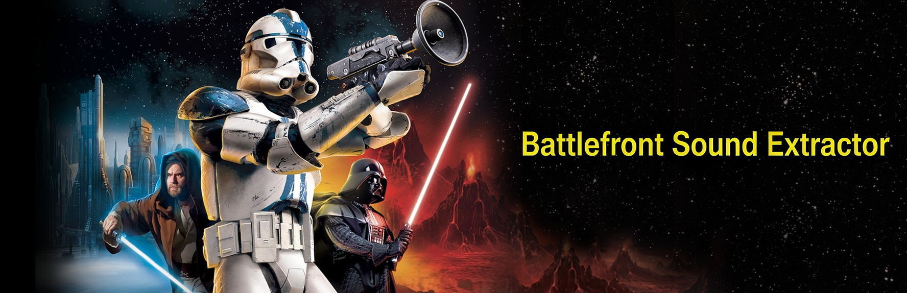

# Battlefront Sound Extractor

> **New here? Find the game's sound files first**
>
> **Star Wars: Battlefront II (Classic, 2005):** Open your game installation folder, then go to
> `GameData\data\_lvl_pc\sound\`
>
> **Star Wars: Battlefront (Classic, 2004):** Open your game installation folder, then go to
> `GameData\Data\_LVL_PC\Sound\`
>
> These folders contain the game's sound `.lvl` files and, depending on the game/version, `.bnk` files. In Steam, you can find the installation folder by right-clicking the game in your Library and choosing **Manage → Browse local files**. Then open the path shown above. If you installed the game somewhere else, use that installation folder instead.


A community-made Python tool for extracting audio from PC sound-bank files used by **Star Wars: Battlefront (2004)** and **Star Wars: Battlefront II (2005)**.

> This is an unofficial community project. It is not affiliated with, endorsed by, or sponsored by Electronic Arts or Lucasfilm. Star Wars and related names are trademarks of their respective owners.

## Features

- Extracts supported `.lvl` and `.bnk` sound files.
- Writes decoded audio as PCM WAV, or can preserve raw audio payloads.
- Optional dictionary file to resolve hashed sound names.
- English-only interface and command-line output on every system, regardless of the operating system language.
- Creates a folder named after each source file, without its extension, beside that source file by default.
- Uses Python's standard library; no third-party package is required for the script itself.

## Requirements

- Python 3.9 or newer is recommended.
- Tkinter is needed for the graphical interface. It is included with most standard Windows Python installations.

## Windows executable

A Windows GUI executable can be built without installing Python on the target PC. The executable must be built on Windows; this source package was prepared in a non-Windows environment, so it does not contain a prebuilt `.exe`.

To build it on a Windows PC, install Python 3.9 or newer, extract the ZIP, and double-click `build_windows.bat`. PyInstaller is installed automatically. When the build finishes, the executable is copied into the main project folder as **`Battlefront Sound Extractor.exe`**. You do not need to open the `dist` folder.

The repository also includes a GitHub Actions workflow at `.github/workflows/build-windows.yml`. After the project is uploaded to GitHub, run **Build Windows executable** from the Actions tab to create a downloadable Windows executable artifact. Pushing a version tag beginning with `v` also triggers a build.

The bundled executable opens the graphical interface. Use the Python script if you need command-line arguments.

## Run from Python

Double-clicking may close a terminal immediately if an error occurs, so running from a terminal is useful for troubleshooting.

```bash
python battlefront_sound_extractor.py
```

This opens the graphical interface. You can also pass input files on the command line:

```bash
python battlefront_sound_extractor.py path/to/shell.lvl
python battlefront_sound_extractor.py path/to/common.bnk -o extracted_audio
python battlefront_sound_extractor.py "path/to/sounds/*.lvl" --format auto
python battlefront_sound_extractor.py path/to/shell.lvl --raw
```

By default, `path/to/shell.lvl` writes to `path/to/shell/`. Use `-o` to choose a different output directory.

## Language

The program is intentionally English-only. The interface and command-line output remain in English on every operating system, making screenshots, bug reports, and community support consistent.

## Tests

Run the built-in regression tests from this folder:

```bash
python -m unittest discover -s tests -v
```

These tests cover the English-only interface, the default output path, basic WAV writing, and empty ADPCM input. They are smoke/regression tests, not a substitute for listening tests with real game files from both games.

## Known limitations

- Sound names may remain hexadecimal hashes unless a compatible dictionary is supplied.
- Different game builds or unusual audio-bank layouts may not all be supported.
- Before calling the tool fully compatible with both games, test representative `.lvl` and `.bnk` files from each game and compare the resulting audio with known-good references.
- The Windows build configuration is included, but a prebuilt `.exe` must be produced on Windows using `build_windows.bat` or GitHub Actions. The local build script copies the finished executable into the main project folder for easy access.

## Project status

This is an independent community utility. Please report the source file, game/version, extraction settings, and relevant error output when reporting a problem. Do not upload copyrighted game assets unless you have the right to share them.


## GUI banner

The GUI displays `Soundtrooper01.png` as a banner when the image is placed beside the Python script. The image is included in the project ZIP. If Pillow is installed, the banner is resized to fit the window; otherwise, Tkinter uses its built-in PNG support when available.
